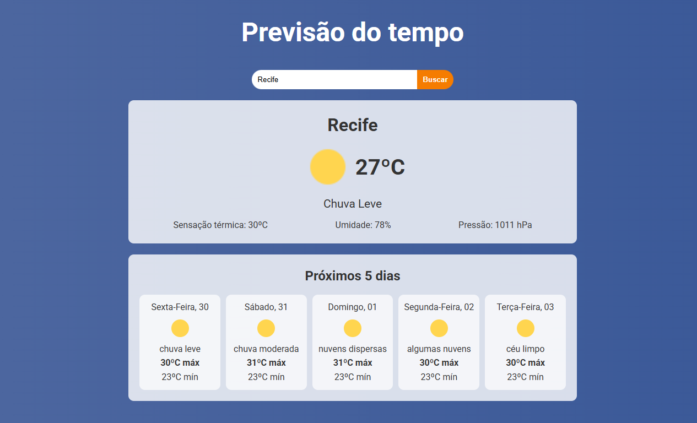
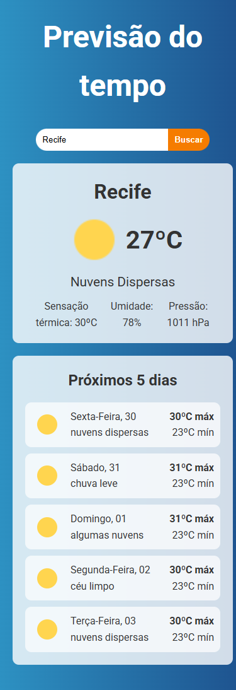

# Previsão do tempo

Aplicação em **React 19** e **TypeScript** que mostra o clima atual e a previsão dos próximos 5 dias de uma cidade, com animações de chuva, neve e nuvens e fundo que muda conforme o tempo. Os dados vêm da API do [OpenWeather](https://openweathermap.org/api), consultada por uma função no servidor para que a chave não fique exposta no navegador.

Acesse online: https://my-app-previsao-tempo.netlify.app/

|                Chuva (desktop)                |                Nuvens (celular)                |
| :-------------------------------------------: | :--------------------------------------------: |
|  |  |

_Capturas feitas com dados de exemplo._

## Funcionalidades

- Busca por nome da cidade (botão **Buscar** ou Enter).
- Clima atual: temperatura, descrição, sensação térmica, umidade e pressão.
- Previsão dos próximos 5 dias, com mínima e máxima de cada dia no fuso da cidade: uma linha por dia no celular e no tablet, e 5 colunas a partir de 1024 px.
- Fundo e animação conforme o código de condição do OpenWeather: chuva (trovoada, garoa e chuva), neve e nuvens; céu limpo não tem animação.
- Mensagens claras para cidade não encontrada, campo vazio e falhas do serviço.
- As animações são desligadas para quem prefere menos movimento (`prefers-reduced-motion`).

## Como funciona a API

O navegador nunca fala com o OpenWeather. Ele chama `/api/weather`, uma função do Netlify (`netlify/functions/weather.ts`) que:

- aceita só `GET` com `type=weather` ou `type=forecast` e `q=<cidade>` (até 100 caracteres);
- consulta `https://api.openweathermap.org/data/2.5/weather` ou `/forecast` com `lang=pt_br` e `units=metric`;
- acrescenta a chave da variável de ambiente `OPENWEATHER_API_KEY`, que não tem o prefixo `VITE_` e por isso nunca entra no JavaScript publicado;
- devolve `404` para cidade inexistente, `400` para pedido inválido e `502` quando o OpenWeather falha, sem repassar detalhes internos.

## Tecnologias

- React 19, TypeScript 6 (modo estrito) e Vite 8
- Tailwind CSS 4
- Netlify Functions
- Vitest, Testing Library, ESLint 10 e Prettier
- GitHub Actions (formatação, lint, testes e build)

## Como rodar

Requer Node `^22.22.3`, `^24.15.0` ou `>=26` e uma chave gratuita do OpenWeather.

```bash
npm install
cp .env.example .env     # preencha OPENWEATHER_API_KEY
npm run dev              # http://localhost:5173
```

Em desenvolvimento, o Vite serve `/api/weather` com a mesma função que roda no Netlify e lê a chave do `.env` (que não vai para o Git).

## Scripts

| Comando                | O que faz                                        |
| ---------------------- | ------------------------------------------------ |
| `npm run dev`          | Servidor de desenvolvimento (com `/api/weather`) |
| `npm run build`        | Verifica os tipos e gera `dist/`                 |
| `npm run preview`      | Serve o build local                              |
| `npm test`             | Testes (Vitest, modo observação)                 |
| `npm run lint`         | ESLint                                           |
| `npm run format`       | Prettier (corrige)                               |
| `npm run format:check` | Prettier (somente verifica)                      |

Para rodar os testes uma vez: `npm test -- --run`.

## Deploy no Netlify

1. Publique pelo repositório no Git (necessário para as Functions serem construídas; arrastar a pasta `dist` não publica a função).
2. Em **Site configuration > Environment variables**, crie `OPENWEATHER_API_KEY` com a sua chave.
3. O `netlify.toml` já define o build (`npm run build`), a pasta `dist` e a pasta das funções.

## Estrutura

```text
netlify/functions/    weather.ts: proxy do OpenWeather (chave só no servidor)
src/
├── App.tsx           formulário, estado da busca e fundo
└── features/weather/
    ├── api/          cliente de /api/weather
    ├── components/   clima atual, previsão e animações
    ├── hooks/        useWeatherSearch (busca com cancelamento)
    ├── utils/        condição do clima e agrupamento dos 5 dias
    └── types.ts      tipos da resposta da API
```

## Decisões

- **Chave no servidor:** uma variável `VITE_*` vai para o JavaScript do navegador; por isso as chamadas passam por uma função.
- **Sem estado global:** a condição do clima é derivada da resposta; o fundo é definido por um atributo `data-condition` no `body`.
- **Condição pelo código da API:** a animação usa o `id` do OpenWeather, e não o texto da descrição, que depende do idioma.
- **Previsão por dia:** o OpenWeather devolve intervalos de 3 horas; eles são agrupados pela data da cidade e a descrição do dia é a do intervalo mais próximo do meio-dia.
- **Tailwind sem preflight:** o visual original depende dos estilos nativos do navegador; o Tailwind entra só com tema e utilitárias, para o layout ficar idêntico ao da versão anterior.
- **Previsão de 5 dias responsiva:** foi a única parte do visual redesenhada em relação à versão original. Os cartões altos empilhados deram lugar a uma linha por dia (celular e tablet) e a 5 colunas (a partir de 1024 px), e o título ficou curto ("Próximos 5 dias") para nunca quebrar de linha.
